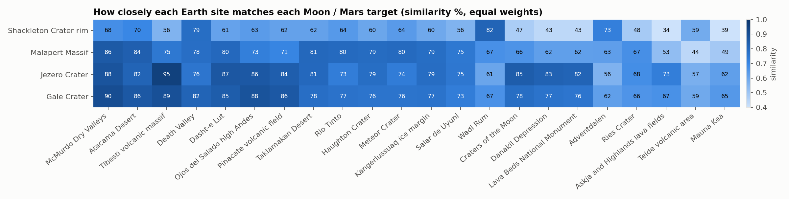

# Earth Analog Finder

NASA Space Apps Challenge 2026 - *Identify Earth Locations that Analog the Permanent Moon Base Locations and Mars*.

Pick a Moon or Mars target site and see which places on Earth best rehearse it. Every match is
**explainable** (per-factor scores, adjustable weights), honest about **where the analogy breaks down**,
and can be explained in plain language by an **AI model** that is only allowed to use the numbers in the data.



> **Status of the numbers:** `data/sites.json` currently holds *placeholder* values so the UI can be built.
> Run the pipeline (below) to replace the Earth values with real NASA POWER + elevation data, and replace the
> Moon/Mars target values in `backend/pipeline/targets.json` with numbers derived from LOLA/Diviner/MOLA/THEMIS.
> The app shows a "Placeholder data" badge until you do. Figures carry a watermark until you run `make_figures.py --final`.

## How it works

1. Each site is described by five factors normalized to 0-1: **slope, roughness, temperature extremes, aridity, volcanic/basaltic geology**.
2. Per-factor similarity = `1 - |target - candidate|`. Overall score = weighted average (equal weights by default).
3. The browser does the scoring (`frontend/scoring.js`), so sliders re-rank instantly. The backend has the identical maths
   (`backend/app/scoring.py`) and a parity script proves they match.
4. `POST /api/explain` sends the two sites' numbers to an AI model and returns a short explanation.
   No API key, or any failure, falls back to a template, so the demo never breaks.

## Repo layout

```
data/sites.json               canonical data (targets + Earth candidates, with provenance)
backend/app/                  FastAPI: scoring.py, ai.py (AI explain), main.py, data.py
backend/pipeline/             build_sites.py (real data), targets.json, sites_seed.json, terrain_from_raster.py
backend/tests/                pytest (scoring + API, AI path tested with a fake client)
backend/scripts/              make_figures.py, check_js_parity.py
frontend/                     reference UI: index.html, app.js, scoring.js, style.css, config.js, assets/
docs/                         FRONTEND_BRIEF.md, SUBMISSION.md, figures/
render.yaml                   one-click backend deploy on Render
```

## Run it locally (VS Code terminal)

```bash
python -m venv .venv
source .venv/bin/activate            # Windows: .venv\Scripts\activate
pip install -r backend/requirements-dev.txt
cp .env.example .env                 # then paste your key (optional - app works without it)

# 1. real data (needs internet; results are cached in backend/pipeline/cache/ - commit them)
python backend/pipeline/build_sites.py

# 2. run API + UI together at http://127.0.0.1:8000
export ANTHROPIC_API_KEY=sk-ant-...  # Windows PowerShell: $env:ANTHROPIC_API_KEY="sk-ant-..."
uvicorn app.main:app --reload --app-dir backend

# 3. checks and figures
cd backend && pytest -q && cd ..
python backend/scripts/check_js_parity.py
python backend/scripts/make_figures.py --final
```

Swagger docs for the API: http://127.0.0.1:8000/docs

## Deploy

**Backend on Render** (simplest: Blueprint)
1. Push to GitHub. In Render: *New > Blueprint*, pick the repo (it reads `render.yaml`).
2. When asked, set `ANTHROPIC_API_KEY` (never put it in the repo). Optionally set `CORS_ORIGINS` to your Vercel URL.
3. Check `https://<your-service>.onrender.com/api/health`. Because the service also serves `frontend/`, this URL is already a working full app.
4. Free Render services sleep when idle; the first request can take ~30-60 s. The UI shows a waiting message for AI calls and the map itself uses static data, so it still works.

**Frontend on Vercel** (optional, if you want the UI on a separate URL)
1. *Add New > Project*, import the repo, set **Root Directory = `frontend`**, Framework = Other (no build step).
2. Edit `frontend/config.js` and set `API_BASE` to your Render URL, commit, push.

## Security

- The API key lives only in Render's environment variables. The browser never sees it.
- `/api/explain` is rate-limited per IP (`EXPLAIN_RATE_LIMIT`, default 30/hour) so a public demo cannot burn your credits.
- `.env` is git-ignored. If a key ever lands in a commit, rotate it.

## Data sources (open)

- NASA POWER climatology (temperature, precipitation) - https://power.larc.nasa.gov
- OpenTopoData elevation API (SRTM/ASTER/Mapzen) - https://www.opentopodata.org
- NASA PDS: LRO LOLA/Diviner (Moon), MRO/MOLA/THEMIS (Mars) - https://pds.nasa.gov
- Basemap imagery: NASA GIBS (Blue Marble), OpenStreetMap

## Known limitations (say these in the pitch)

- Earth cannot reproduce reduced gravity, lunar vacuum, the thin Martian atmosphere or radiation. Each site card states its own limits.
- Temperature is a proxy: annual air-temperature range for Earth vs surface temperature range for Moon/Mars.
- Aridity is a proxy (the Moon and Mars have no rain or vegetation).
- Geology ("basaltic") is hand-tagged and flagged `estimated`.
- A curated candidate set, not an exhaustive global search (see Future work in `docs/SUBMISSION.md`).
